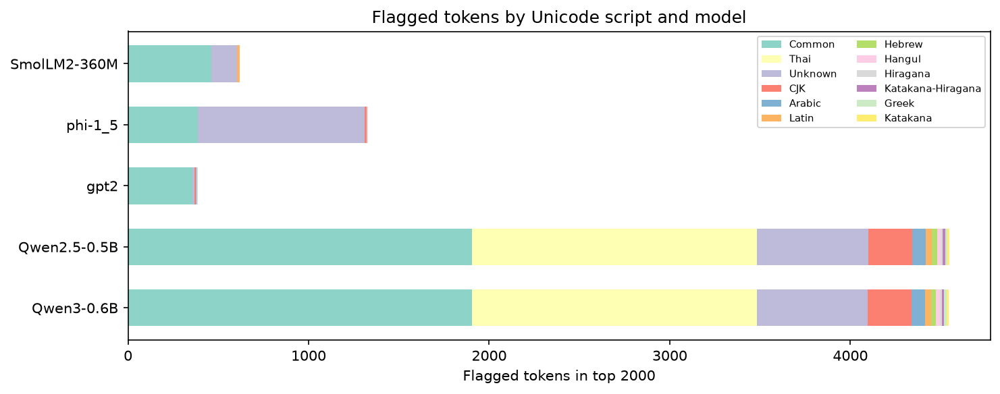

# glitchfinder

Detect under-trained ("glitch") tokens in open-weight LLMs from embedding matrices alone.

**[Live explorer](https://crs7617.github.io/glitchfinder/)** — browse results interactively.



## What are glitch tokens?

Every LLM has a fixed vocabulary of tokens. Most get used millions of times during training and develop meaningful representations. But some tokens barely appear — their embeddings are degenerate, and forcing the model to use them produces bizarre output. These are **glitch tokens**.

GPT-2's vocabulary still contains `externalToEVA`, `rawdownload`, and `RandomRedditorWithNo` — tokens it essentially never learned. Qwen3-0.6B has 19 confirmed tokens (rare Arabic ligatures, Hangul syllables, an Egyptian hieroglyph) that the model predicts with less than 0.003% probability in any context we tested.

## Results

| Model | Vocab | Indicator | Flagged | Verified |
|-------|------:|-----------|--------:|----------|
| [Qwen3-0.6B](https://huggingface.co/Qwen/Qwen3-0.6B) | 151,936 | cosine distance | 1,981 | **19/19 confirmed** |
| [Qwen2.5-0.5B](https://huggingface.co/Qwen/Qwen2.5-0.5B) | 151,936 | cosine distance | 1,890 | candidates only |
| [GPT-2](https://huggingface.co/openai-community/gpt2) | 50,257 | cosine distance | 84 | candidates only |
| [SmolLM2-360M](https://huggingface.co/HuggingFaceTB/SmolLM2-360M) | 49,152 | cosine distance | 118 | candidates only |
| [Phi-1.5](https://huggingface.co/microsoft/phi-1_5) | 51,200 | L2 norm | 967 | candidates only |

"Flagged" = tokens ranked suspicious by the indicator in the top 2,000. "Verified" = model loaded, 3 prompt templates tested, max probability < 1%.

## How it works

1. **Load embeddings** — reads only the embedding tensor from safetensors files, never the full model
2. **Analyze tokenizer** — classifies each token as special, unreachable, or partial UTF-8, and detects Unicode scripts
3. **Compute indicators** — for tied models: cosine distance from a "garbage centroid" of known-unused tokens; for untied models: L2 norm (weight decay pushes unused embeddings toward zero)
4. **Verify** (optional, models ≤1B only) — loads the full model and tests each candidate with 3 prompt templates; if max probability < 1%, confirmed as a glitch
5. **Report** — JSON with per-token scores, flags, verification results, and per-script statistics

Methodology from Land & Bartolo (2024), ["Fishing for Magikarp"](https://arxiv.org/abs/2405.05417) (arXiv 2405.05417). This is an independent implementation.

## Try it yourself

Requires Python 3.12+ and [uv](https://docs.astral.sh/uv/).

```bash
git clone https://github.com/crs7617/glitchfinder.git
cd glitchfinder
uv sync --dev
```

Analyze any HuggingFace model that has safetensors weights:

```bash
# Indicators only (fast, works on any model size)
uv run glitchfinder analyze Qwen/Qwen3-0.6B --no-verify --show-top 30

# With verification (model must be ≤1B parameters)
uv run glitchfinder analyze openai-community/gpt2 --show-top 30

# Batch run all preconfigured models
uv run python scripts/batch_analyze.py
```

Results are saved as JSON in `results/`. To update the site:

```bash
uv run python scripts/build_site_data.py    # trim results → site/data/
uv run python scripts/generate_chart.py      # generate chart PNG
python -m http.server -d site                # preview at localhost:8000
```

## Run tests

```bash
uv run pytest -q
```

77 tests covering embedding extraction, tokenizer analysis, indicator math, verification logic, report generation, and an offline end-to-end test with synthetic safetensors data.

## Limits

- **Safetensors only.** Models with only `.bin` weights are skipped with a clear error.
- **CPU, 8 GB RAM.** Designed for machines without a GPU. Very large embedding matrices (200k+ vocab with 8192+ hidden dim) may not fit.
- **Verification limited to ≤1B models.** Larger models produce indicator-ranked candidates, not confirmed glitches.
- **Indicators are heuristics.** A low-norm or centroid-proximate token may be legitimate but rare. Verification helps, but 3 prompt templates don't cover every possible context.

## Project structure

```
src/glitchfinder/
    models.py            Embedding extraction from safetensors
    tokenizer_pass.py    Token classification (special, unreachable, scripts)
    indicators.py        Pure indicator functions (L2 norm, cosine distance)
    verify.py            Model-based verification (≤1B, 3 prompt templates)
    report.py            JSON report generation
    cli.py               CLI entry point and pipeline orchestration
scripts/
    batch_analyze.py     Run analysis on multiple models
    build_site_data.py   Trim results for the static site
    generate_chart.py    Generate the chart PNG
site/                    Static explorer (deployed to GitHub Pages)
tests/                   77 tests
```

## Citation

> Land, S., & Bartolo, M. (2024). Fishing for Magikarp: Automatically Detecting Under-trained Tokens in Large Language Models. *arXiv:2405.05417*.

## License

MIT
